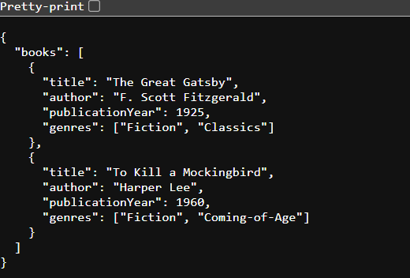
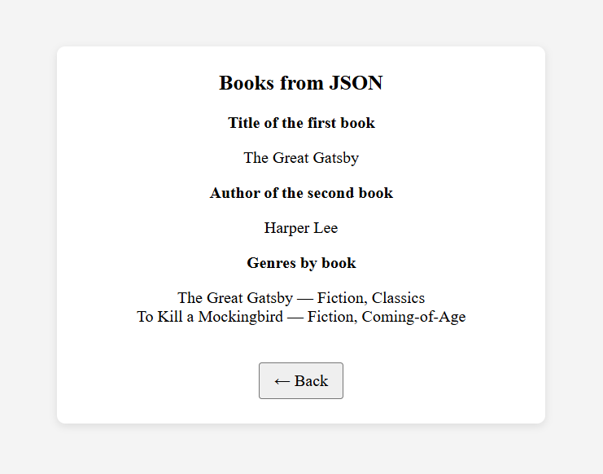
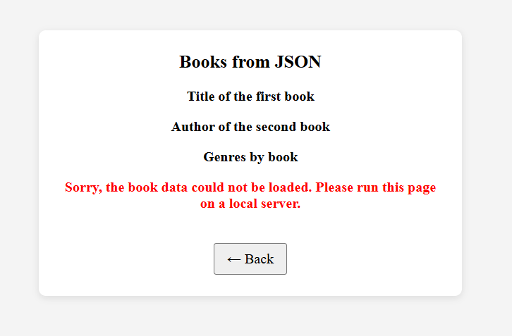
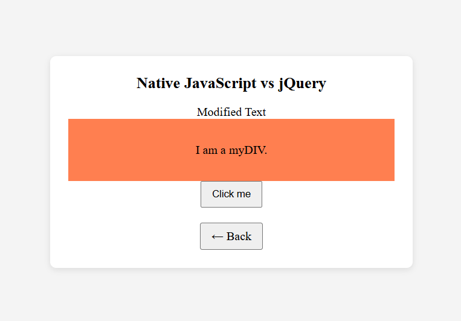
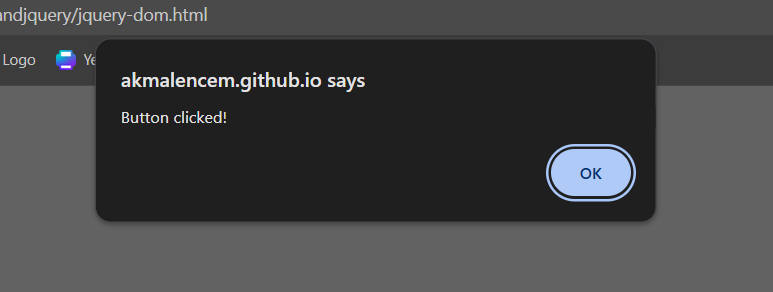

# BIC21203 Lab 4b: Client-Side Scripting (JSON and jQuery)

**Name:** Muhammad Akmal Asri Bin Kamal
**Student ID:** CI250026
**Course:** BIC21203 Web Development
**Faculty:** Faculty of Computer Science and Information Technology, UTHM

**Live demo:** https://akmalencem.github.io/bic21203-lab4b-jsonandjquery/

## About

This lab has three parts. It creates a JSON dataset, loads and displays that data with the native `fetch()` API, and compares native JavaScript DOM code with the jQuery 4.0.0 equivalents. Text is inserted with `textContent` and `createElement()` (no `innerHTML`).

## Project Structure

| File | Description |
| --- | --- |
| `index.html` | Home page that links to Q1, Q2 and Q3 |
| `books.json` | Question 1: JSON dataset of two books |
| `books.html` | Question 2: Retrieve and display JSON data with `fetch()` |
| `jquery-dom.html` | Question 3: jQuery DOM and events |

Every question page has a Back button that returns to `index.html` except question 1 page.

## How to Run

`fetch()` does not work when a page is opened directly with `file://`, so Q2 must be run through a server.

1. Open the live demo link above (GitHub Pages serves the files over HTTPS), **or**
2. Download this repository, open the folder in VS Code, install the **Live Server** extension, then right-click `index.html` and choose **Open with Live Server**.
3. Choose a question from the home page.

### Q1: Create and Structure JSON Data
`books.json` has a top-level `"books"` array with two book objects. Each book has `title` (string), `author` (string), `publicationYear` (number) and `genres` (array of strings). It uses double-quoted property names and has no trailing commas.

The file parses successfully, because `books.html` loads it without errors.

### Q2: Retrieve and Display JSON Data
1. Open `books.html` through a local server or the live demo.
2. The page uses `fetch("books.json")` and displays:
   - Title of the first book: The Great Gatsby
   - Author of the second book: Harper Lee
   - Genres grouped by book:
     - The Great Gatsby — Fiction, Classics
     - To Kill a Mockingbird — Fiction, Coming-of-Age
3. If the request fails or the JSON is invalid, a friendly error message is shown instead. This can be seen by opening `books.html` directly with `file://`.

The data is loaded with `async/await` inside a `try...catch`, and the list is built with `document.createElement()` and `textContent`.

### Q3: Compare Native JavaScript and jQuery
1. Open `jquery-dom.html`. It uses the jQuery 4.0.0 full build from the official CDN: `https://code.jquery.com/jquery-4.0.0.min.js`.
2. On page load, the text of `#myElement` changes to "Modified Text" and `#myDIV` gets the `myStyle` class (coral background).
3. Click **Click me**. An alert shows "Button clicked!".

The three jQuery methods used are `.text()`, `.addClass()` and `.on("click", ...)`.

## Screenshots

### Q1

### Q2

### Q3

